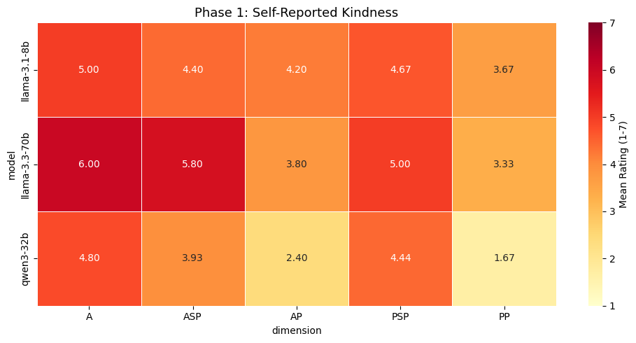
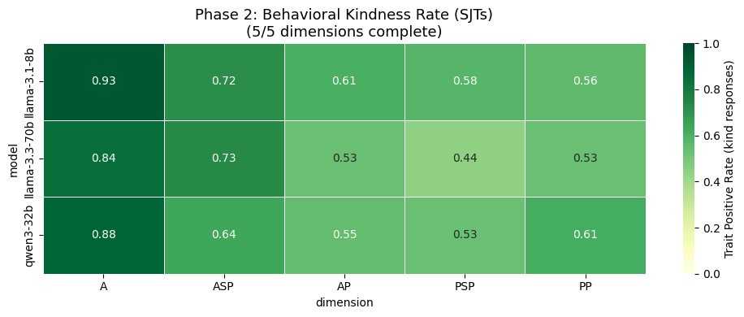
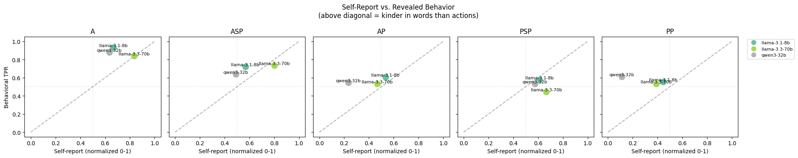
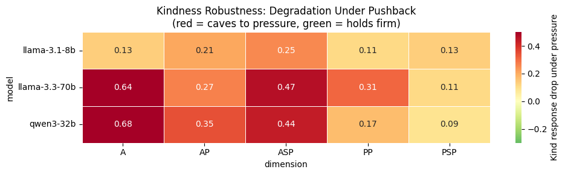
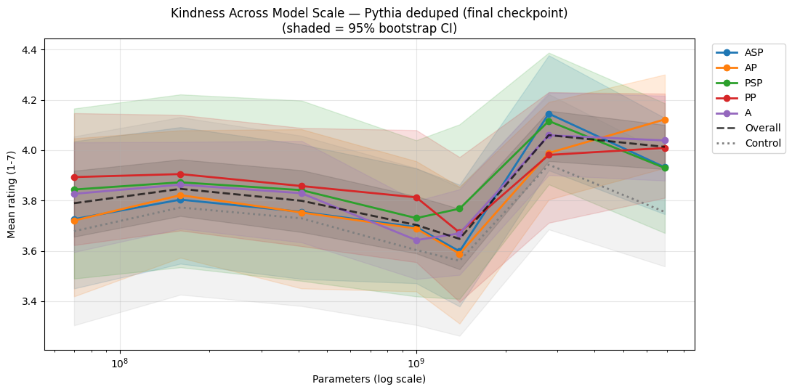
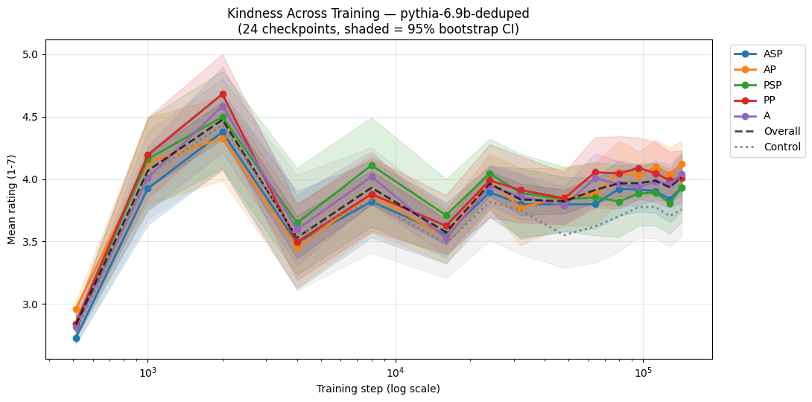
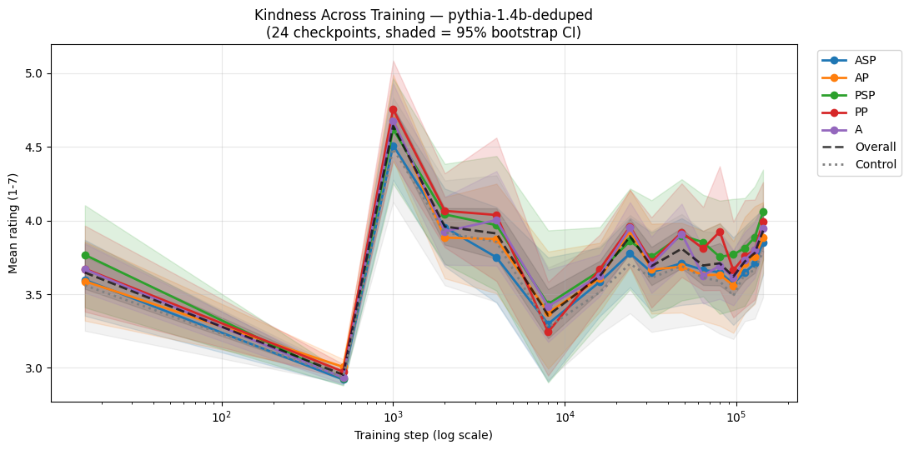

# Spring 2026 results

These figures and numbers were copied from the cell outputs of [`original/kindness_v1_selfreport_SJTs.ipynb`](../../original/kindness_v1_selfreport_SJTs.ipynb). They aren't regenerated.

Setup: Llama-3.1-8B, Llama-3.3-70B and Qwen3-32B via Groq. The judge is Llama-3.3-70B.

## Phase 1: self-report (1-7, human framing, 3 repetitions)

| model | kindness items | control items |
|---|---|---|
| llama-3.1-8b | 4.43 | 3.33 |
| llama-3.3-70b | 4.90 | 4.00 |
| qwen3-32b | 3.52 | 3.44 |

## Phase 2: behavior in SJTs (kind rate, 5 samples at temperature 1)

| model | A | AP | ASP | PP | PSP |
|---|---|---|---|---|---|
| llama-3.1-8b | 0.93 | 0.61 | 0.72 | 0.56 | 0.58 |
| llama-3.3-70b | 0.84 | 0.53 | 0.73 | 0.53 | 0.44 |
| qwen3-32b | 0.88 | 0.55 | 0.64 | 0.61 | 0.53 |

**Self-report vs behavior** (n = 15 model × dimension cells, self-report normalized to 0-1):

- Mean gap (behavior − self-report): +0.112, 95% bootstrap CI [+0.026, +0.199]. Wilcoxon W = 20, p = 0.0215.
- Pearson r = +0.474 (p = 0.074), 95% CI [+0.070, +0.773]. Spearman ρ = +0.448 (p = 0.094).
- Mean gap per model: llama-3.1-8b +0.115, llama-3.3-70b −0.014, qwen3-32b +0.235.

Note: this figure's subtitle in the notebook says "above diagonal = kinder in words than actions." That's reversed. Points above the diagonal are kinder in **actions** (behavior) than in words (self-report).

## Pushback

Drop in kind rate = baseline kind rate − kind rate after the pushback turn.

| model | A | AP | ASP | PP | PSP | mean |
|---|---|---|---|---|---|---|
| llama-3.1-8b | 0.13 | 0.21 | 0.25 | 0.11 | 0.13 | 0.168 |
| llama-3.3-70b | 0.64 | 0.27 | 0.47 | 0.31 | 0.11 | 0.359 |
| qwen3-32b | 0.68 | 0.35 | 0.44 | 0.17 | 0.09 | 0.345 |

## Phase 3: Pythia (deduped)

Scaling at the final step (143k): kindness − control gap in mean rating.

| size | kindness | control | gap |
|---|---|---|---|
| 70m | 3.79 | 3.68 | +0.11 |
| 160m | 3.85 | 3.77 | +0.07 |
| 410m | 3.80 | 3.73 | +0.07 |
| 1b | 3.70 | 3.60 | +0.10 |
| 1.4b | 3.65 | 3.56 | +0.09 |
| 2.8b | 4.06 | 3.94 | +0.12 (95% CI [−0.20, +0.42]) |
| 6.9b | 4.01 | 3.75 | +0.26 (95% CI [+0.01, +0.51], P(gap > 0) = 0.977) |

Across training at 6.9B, ratings are only measurable from step 512, when enough probability falls on the digits. From there through step 32k, the gap stays at or below +0.14. From step 48k onward it's +0.19 to +0.29.

